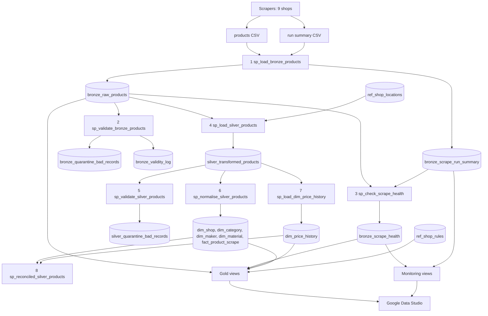

# Pipeline Manual

Operation and maintenance guide for the Statement competitor data warehouse.

| | |
|---|---|
| Platform | Google BigQuery |
| Project | `statement-competitor-pipeline` |
| Dataset | `statement_competitor_data_warehouse` |
| Source | One combined scrape CSV per run, plus an optional run summary CSV, in a Cloud Storage bucket |
| Consumers | Google Data Studio, ad hoc SQL |
| Version | V2, 2026-10-23 |

---

## Contents

1. [Architecture](#1-architecture)
2. [Repository layout](#2-repository-layout)
3. [Data flow](#3-data-flow)
4. [First-time setup](#4-first-time-setup)
5. [Running the pipeline](#5-running-the-pipeline)
6. [Pipeline steps in detail](#6-pipeline-steps-in-detail)
7. [Data quality rules](#7-data-quality-rules)
8. [Scrape health and the run summary](#8-scrape-health-and-the-run-summary)
9. [Product lifecycle](#9-product-lifecycle)
10. [Gold views and Data Studio](#10-gold-views-and-data-studio)
11. [Object reference](#11-object-reference)
12. [Routine checks](#12-routine-checks)
13. [Maintenance tasks](#13-maintenance-tasks)
14. [Troubleshooting](#14-troubleshooting)
15. [Safety rules](#15-safety-rules)
16. [Known limitations and open items](#16-known-limitations-and-open-items)

---

## 1. Architecture

Medallion architecture in one BigQuery dataset. Layers are separated by table prefix.

| Layer | Prefix | Object type | Load | Purpose |
|---|---|---|---|---|
| Bronze | `bronze_` | Tables | Append | Scraped data exactly as received (all `STRING`), plus logs and quarantine |
| Silver | `silver_`, `dim_`, `fact_` | Tables | MERGE (changed rows only) | Cleaned, typed, validated data; star schema; price history (SCD Type 2) |
| Reference | `ref_` | Tables | Manual | Hand-maintained shop coordinates and shop rules |
| Gold | `gold_` | Views | None | Business-ready star schema, lifecycle, market insight |
| Monitoring | `mon_` | Views | None | Scrape run overview for engineers |

Principles:

- **Bronze is never modified.** Cleaning happens in Silver.
- **DDL never destroys data.** Every table is `CREATE TABLE IF NOT EXISTS`. Views are `CREATE OR REPLACE VIEW` (they hold no data).
- **Only changed rows are rewritten** in Silver, the dimensions and the fact table.
- **Every procedure logs** a start, a completion and any error to its own log table, and re-raises errors so the caller stops.
- **Facts are separated from interpretation.** Silver records what was observed; Gold decides what it means (e.g. sold or delisted).

---

## 2. Repository layout

```
01_DDL/                                   Run once during setup (safe to re-run)
  01_create_dataset.sql
  02_create_bronze_tables.sql
  03_create_silver_tables.sql
  04_create_reference_tables.sql
  05_create_gold_views.sql
  06_create_gold_lifecycle_views.sql
  07_create_gold_market_views.sql
  08_create_monitoring_views.sql
02_Stored_Procedures/                     Deploy once; redeploy after any change
  01_sp_load_bronze_products.sql          Step 1
  02_sp_validate_bronze_products.sql      Step 2
  03_sp_check_scrape_health.sql           Step 3
  04_sp_load_silver_products.sql          Step 4
  05_sp_validate_silver_products.sql      Step 5
  06_sp_normalise_silver_products.sql     Step 6
  07_sp_load_dim_price_history.sql        Step 7
  08_sp_reconciled_silver_products.sql    Step 8
  09_sp_run_pipeline.sql                  Runs steps 1-8
03_Documentation/                         Diagrams (draw.io XML) and this manual
04_Scraper/scrape_run_summary.py          Helper that writes the run summary CSV
datasets/                                 Local CSVs (git-ignored, never committed)
```

Every script has the same header:

| Field | Meaning |
|---|---|
| Script | File name |
| Layer | Bronze, Silver, Reference, Gold, Monitoring or All |
| Purpose | What it does |
| When | When to run or deploy it |
| Requires | What must exist or run first |
| Params | Procedure parameters |
| Logs | Log tables written |
| Warning | What to watch out for |

Every script ends with a commented-out **Tests** block: the `CALL` statements and verification queries for that step. Select and run them manually.

---

## 3. Data flow



Batch identifiers trace every row back to its run:

| Procedure | `batch_id` format |
|---|---|
| sp_load_bronze_products | `BATCH_YYYYMMDD_HHMMSS` (the Bronze batch, used by steps 2-4) |
| sp_load_silver_products | `BATCH_SLV_YYYYMMDD_HHMMSS` |
| sp_validate_silver_products | `BATCH_VAL_YYYYMMDD_HHMMSS` |
| sp_normalise_silver_products | `BATCH_NORM_YYYYMMDD_HHMMSS` |
| sp_load_dim_price_history | `BATCH_HIST_YYYYMMDD_HHMMSS` |
| sp_reconciled_silver_products | `BATCH_REC_YYYYMMDD_HHMMSS` |

`execution_id` is a UUID per procedure run.

---

## 4. First-time setup

Run in DataGrip, in this order.

| Step | Run | Creates |
|---|---|---|
| 1 | `01_DDL/01` to `08` | Dataset, tables, reference data, views |
| 2 | `02_Stored_Procedures/01` to `09` | Procedures (each file's `CREATE OR REPLACE PROCEDURE` block) |
| 3 | Tests block of each DDL script | Confirms objects exist |

### One-off migrations (existing installations only)

| Situation | Action |
|---|---|
| Old Gold **tables** exist (`gold_dim_*`, `gold_fact_*`) | Check `row_count = 0`, then run the `DROP TABLE` block at the bottom of `05_create_gold_views.sql`. A view cannot replace a table. |
| Procedures deployed before V2 | Redeploy all procedures. `sp_load_silver_products` and `sp_validate_silver_products` now take a parameter; old calls without one fail. |
| Tables created before V2 | Re-run `01_DDL/02` and `04`. They add new columns with `ADD COLUMN IF NOT EXISTS`. |

---

## 5. Running the pipeline

### Normal run (one scrape file)

1. Upload `<name>.csv` and `<name>_run_summary.csv` to the same bucket folder.
2. Run:

```sql
CALL statement_competitor_data_warehouse.sp_run_pipeline('gs://<bucket>/<name>.csv');
```

`NULL` uses the default file `gs://statement_competitor_data_warehouse/MCM_All_products.csv`.

3. Do the [after-every-run checks](#121-after-every-run).

**Run once per file.** Step 1 appends the whole file; running twice loads it twice.

### Running steps individually

```sql
CALL statement_competitor_data_warehouse.sp_load_bronze_products(NULL);        -- 1
CALL statement_competitor_data_warehouse.sp_validate_bronze_products(NULL);    -- 2
CALL statement_competitor_data_warehouse.sp_check_scrape_health(NULL);         -- 3
CALL statement_competitor_data_warehouse.sp_load_silver_products(NULL);        -- 4
CALL statement_competitor_data_warehouse.sp_validate_silver_products(NULL);    -- 5
CALL statement_competitor_data_warehouse.sp_normalise_silver_products();       -- 6
CALL statement_competitor_data_warehouse.sp_load_dim_price_history();          -- 7
CALL statement_competitor_data_warehouse.sp_reconciled_silver_products();      -- 8
```

`NULL` means "the latest batch" for each step:

| Step | `NULL` resolves to |
|---|---|
| 2 | Most recently loaded Bronze batch |
| 3, 4 | Most recently validated Bronze batch (`bronze_validity_log`) |
| 5 | Most recent completed Silver load (`INFO_STAGE_COMPLETE` in `silver_transformed_error_logs`) |

**Process one batch at a time.** If two files were loaded before Silver ran, call steps 3-8 for the older batch first (passing its `batch_id`), then again with `NULL`.

### Failure behaviour

Each step raises on a SQL error, so `sp_run_pipeline` stops at that step. Data issues (quarantined rows, failed scrapes, reconciliation findings) are logged and do **not** stop the run.

---

## 6. Pipeline steps in detail

### Step 1: `sp_load_bronze_products(p_gcs_uri)`

| | |
|---|---|
| Reads | `<name>.csv`, `<name>_run_summary.csv` (same folder) |
| Writes | `bronze_raw_products`, `bronze_scrape_run_summary` |
| Logs | `bronze_raw_error_logs` |

Logic:

1. Generates a new Bronze `batch_id`.
2. Loads the CSV into a session staging table with `LOAD DATA` (header row skipped, quoted newlines allowed).
3. Appends all rows to `bronze_raw_products` with `execution_id`, `batch_id`, `ingested_at`.
4. Loads the run summary into `bronze_scrape_run_summary` under the same `batch_id`. A missing or unreadable summary logs `RUN_SUMMARY_MISSING` and the load continues.

Error types: `SCHEMA_MISMATCH`, `PARSING_FAILURE`, `ACCESS_DENIED`, `BULK_LOAD_FAILURE`.

### Step 2: `sp_validate_bronze_products(p_batch_id)`

| | |
|---|---|
| Reads | `bronze_raw_products` (one batch) |
| Writes | `bronze_quarantine_bad_records`, `bronze_validity_log` |
| Logs | `bronze_raw_error_logs` |

Rules (a row failing either is quarantined as JSON):

1. URL present: not NULL, empty or whitespace. Reason `URL is null or empty`.
2. Price parseable: after removing everything except digits, `.` and `-`, it casts to a number. Reason `Price not parseable` (e.g. "Contact for Price").

Bronze rows are not changed. Re-running for a batch replaces that batch's quarantine rows. The `bronze_validity_log` entry is what allows step 4 to load the batch.

### Step 3: `sp_check_scrape_health(p_batch_id)`

| | |
|---|---|
| Reads | `bronze_raw_products`, `bronze_quarantine_bad_records`, `bronze_scrape_run_summary`, `ref_shop_rules` |
| Writes | `bronze_scrape_health` (one row per shop) |
| Logs | `bronze_raw_error_logs` (`SCRAPE_FAILED` / `SCRAPE_WARNING` per shop) |

Compares each shop's part of the batch with that shop's last 3 non-failed scrapes and with the scraper's own run summary. See [section 8](#8-scrape-health-and-the-run-summary). Never stops the pipeline for data issues.

### Step 4: `sp_load_silver_products(p_bronze_batch_id)`

| | |
|---|---|
| Reads | `bronze_raw_products` (one validated batch), `ref_shop_locations` |
| Writes | `silver_transformed_products` |
| Logs | `silver_transformed_error_logs` |

Logic:

1. Refuses to run unless the batch is in `bronze_validity_log`.
2. Skips rows Bronze validation quarantined (same URL and price rules).
3. Cleans and types every column ([section 7](#7-data-quality-rules)).
4. Overrides coordinates with `ref_shop_locations` for known shops.
5. Keeps the latest row per URL (by scrape time; rows without one sort last).
6. MERGE on `url`: inserts new products; updates a product only when a data column changed. A new scrape time alone is not a change.
7. Logs `Transformation COMPLETED for Bronze batch <id>. Rows inserted or changed: <n> ...`.

**Do not change the completion log wording.** Step 8 reads the Bronze batch id from it.

Error types: `CASTING_FAILURE`, `MERGE_FAILURE`, `TRANSFORMATION_FAILURE`.

### Step 5: `sp_validate_silver_products(p_silver_batch_id)`

| | |
|---|---|
| Reads | `silver_transformed_products` (rows written by one Silver load) |
| Writes | `silver_quarantine_bad_records`, `silver_validity_log`; deletes failed rows from Silver |
| Logs | `silver_transformed_error_logs` |

Rules (all mandatory):

| Rule | Quarantine reason |
|---|---|
| URL present | `MISSING_URL` |
| Shop name present (not empty, a placeholder or 'Unknown') | `MISSING_SHOP_NAME` |
| Price present | `MISSING_PRICE` |
| Price between 0 and 999,999.99 | `PRICE_OUT_OF_RANGE` |

Failed rows are copied to quarantine with all reasons, then deleted from Silver. Only rows from the given load are checked; the rest of the table is untouched. Safe to re-run.

**Watch out:** a product whose latest scrape fails is removed from Silver, even if an earlier version was valid.

### Step 6: `sp_normalise_silver_products()`

| | |
|---|---|
| Reads | `silver_transformed_products` |
| Writes | `dim_shop`, `dim_category`, `dim_maker`, `dim_material`, `fact_product_scrape` |
| Logs | `silver_normalised_error_logs` |

Logic:

1. Builds a key per value: lower case, trimmed, single spaces. `FARM_FINGERPRINT` of that key is the surrogate id, so "Teak", "teak" and "Teak " share one key.
2. Display name: the most common original spelling.
3. `dim_shop`: most common known region, city and coordinates per shop ('Unknown' and NULL ignored). Existing shops are updated when these change.
4. `fact_product_scrape`: one row per URL (`product_id` = `FARM_FINGERPRINT(url)`), latest row per URL, changed rows only.
5. Deletes dimension rows no fact row references.

Error types: `NORMALISATION_MERGE_FAILURE`, `HASH_GENERATION_FAILURE`, `GENERAL_NORMALISATION_FAILURE`.

### Step 7: `sp_load_dim_price_history()`

| | |
|---|---|
| Reads | `silver_transformed_products`, `dim_price_history` |
| Writes | `dim_price_history` |
| Logs | `silver_historisation_error_logs` |

SCD Type 2. Logic:

1. Stages new products and products whose price or availability differs from the current version (`IS DISTINCT FROM`, so changes to and from NULL count).
2. Effective time = scrape time (run time if unknown), never earlier than the current version's `valid_from`.
3. In one transaction: expires the current version (`valid_to` = effective time, `is_current = FALSE`) and inserts the new version (`valid_from` = effective time, `valid_to = 9999-12-31 23:59:59 UTC`, `is_current = TRUE`).
4. On error: rolls back, logs `HISTORISATION_FAILURE`, re-raises.

No gaps or overlaps between versions. **This history cannot be rebuilt.**

### Step 8: `sp_reconciled_silver_products()`

| | |
|---|---|
| Reads | Bronze, Silver, star schema, price history, scrape health |
| Writes | `silver_reconciled_error_logs` (one row per failed check) |

| Check | Finds | Usual fix |
|---|---|---|
| `DATA_DROP_MISMATCH` | Eligible Bronze URLs in neither Silver nor quarantine | Investigate step 4 |
| `SCRAPE_FAILURE` | Shop scrapes marked FAILED, or batch never health-checked | See [section 8](#8-scrape-health-and-the-run-summary) |
| `UNVALIDATED_RECORDS` | Silver rows breaking mandatory rules | Run step 5 |
| `MISSING_FACT_ROW` | Silver products without a fact row | Run step 6 |
| `ORPHAN_KEY` | Fact rows pointing to missing dimension rows | Run step 6 |
| `MISSING_PRICE_HISTORY` | Silver products without a current version | Run step 7 |
| `DUPLICATE_CURRENT_VERSION` | More than one current version per product | Investigate step 7 |
| `PRICE_HISTORY_OUT_OF_DATE` | Current version differs from Silver | Run step 7 |
| `INVALID_HISTORY_INTERVAL` | Version ends before it starts | Investigate step 7 |
| `FINANCIAL_ANOMALY` | Average Silver price not above zero | Investigate price parsing |

The completion log reads `Silver Layer Reconciliation completed: <x> of <n> checks found issues`. Data issues do not fail the procedure.

---

## 7. Data quality rules

Applied in step 4. Placeholders treated as missing: empty, whitespace, `NULL`, `NONE`, `NAN`, `N/A`, `-` (case-insensitive).

| Column | Rule | When missing |
|---|---|---|
| shop_name | Trimmed | NULL (quarantined in step 5); 'UNKNOWN' also counts as missing |
| region, city | Trimmed | `Unknown` |
| title | Trimmed | `Unknown` |
| category | Trimmed | `Uncategorised` |
| description, dimensions, makers, primary_material, era, condition | Trimmed | `-1` (shown as `Unknown` in Gold) |
| url | Trimmed | Row skipped |
| price | Keep digits, `.` and `-`; cast to NUMERIC; round to 2 decimals | NULL (quarantined in step 5) |
| latitude | Number between -90 and 90 | NULL (never -1.0) |
| longitude | Number between -180 and 180 | NULL |
| available | See table below | NULL (unknown, never assumed sold) |
| scrape time | Formats below | NULL (never replaced with run time) |

Availability values (case-insensitive):

| Result | Values |
|---|---|
| TRUE | `true`, `t`, `yes`, `y`, `1`, `1.0`, `available`, `in stock`, `instock`, `in_stock`, `for sale` |
| FALSE | `false`, `f`, `no`, `n`, `0`, `0.0`, `sold`, `sold out`, `soldout`, `sold_out`, `out of stock`, `outofstock`, `out_of_stock`, `unavailable`, `not available` |
| NULL | Anything else |

Scrape time formats: `YYYY-MM-DD HH:MM:SS[.fff]`, `YYYY-MM-DDTHH:MM:SS[.fff]`, `YYYY-MM-DDTHH:MM:SSZ`, and anything BigQuery casts to TIMESTAMP.

**Price caveats:**

- `R 2,500.00` becomes 2500.00. Correct.
- `-500` stays negative and is quarantined in step 5.
- `R1500 - R2000` (a range) fails Bronze validation and is quarantined.
- `R 1 500,00` (comma as decimal) becomes **150000**. Check price formats regularly ([section 12](#12-routine-checks)).
- `R0.00` is kept as a real price. Gold treats it as sold if the shop rule says so.

---

## 8. Scrape health and the run summary

### Run summary file

Written by the scraper's compile script with `04_Scraper/scrape_run_summary.py` and uploaded next to the products CSV as `<name>_run_summary.csv`. Optional: without it, only the warehouse checks run.

| Column | Example | Meaning |
|---|---|---|
| run_id | `2b47d3b0-...` | Same for every shop in one run |
| shop_name | `shop_1` | Exactly as in the products CSV |
| started_at / finished_at | `2026-10-22 08:00:00` | UTC |
| status | `SUCCESS`, `PARTIAL`, `FAILED` | Scraper's own verdict |
| pages_scraped | `13` | Listing pages visited |
| products_found | `312` | Products extracted |
| products_expected | `312` | Count the site shows ("of 312 results"); blank if not shown |
| http_errors / retries | `0` | Request failures and retries |
| error_message | `TimeoutError: ...` | Blank on success |
| scraper_version | `1.0.0` | Scraper release |

Python usage:

```python
from scrape_run_summary import RunSummary, summary_path_for

summary = RunSummary(scraper_version="1.0.0")
for shop_name, scrape in SCRAPERS.items():
    with summary.shop(shop_name) as shop:
        shop.products_expected = 312            # site's own count, if shown
        for page in scrape.pages():
            shop.pages_scraped += 1
            shop.products_found += len(page.products)
        if scrape.stopped_early:
            shop.mark_partial("Stopped at page 7 of 13")
    # An exception inside the block marks the shop FAILED; the loop continues.
summary.write(summary_path_for("MCM_All_products.csv"))
```

### Health checks

| Status | Check | Triggered when (default threshold) |
|---|---|---|
| FAILED | `SHOP_MISSING` | Shop from the last 3 batches or the run summary has no rows |
| FAILED | `LOW_PRODUCT_COUNT` | Products below 70% of the shop's baseline (median of last 3 non-failed scrapes) |
| FAILED | `HIGH_QUARANTINE_RATE` | More than 20% of the shop's rows quarantined |
| FAILED | `STALE_SCRAPE` | Latest scrape time not newer than the previous scrape |
| FAILED | `SCRAPER_FAILED` | Run summary status FAILED |
| FAILED | `SCRAPER_PARTIAL` | Run summary status PARTIAL |
| FAILED | `BELOW_SITE_COUNT` | Products below 90% of the site's own count |
| WARNING | `FIELD_DROPOUT` | A normally filled field (under 10% empty before) is more than 50% empty |
| WARNING | `DUPLICATE_URLS` | More than 5% repeated URLs |
| WARNING | `CSV_COUNT_MISMATCH` | CSV product count differs from the run summary |
| WARNING | `SUMMARY_MISSING` | Batch has a run summary, but not for this shop |

**What FAILED does:** the shop's rows still load into Silver (real observations), but the Gold lifecycle views ignore that scrape when deciding whether a product was delisted. A partial scrape therefore never creates false "sold" signals.

**First batch:** no history, so only the quarantine and duplicate checks (and run summary checks) apply.

Thresholds live in `ref_shop_rules` (`min_count_ratio`, `max_quarantine_rate`, `max_duplicate_rate`, `max_field_empty_rate`, `min_expected_ratio`). A shop row overrides the `'*'` default; NULL falls back to the default.

---

## 9. Product lifecycle

Built from facts in `06_create_gold_lifecycle_views.sql`.

### Presence

`gold_product_presence`: for every product, one row per scrape of its shop from its first sighting, with `is_present`. Each scrape is a full snapshot of the shop. Excluded:

- `TEST_` batches
- Duplicate loads (same shop and same scrape time)
- Scrapes marked FAILED in `bronze_scrape_health`

### Events

`gold_product_events`:

| Event | Rule |
|---|---|
| `NEW_LISTING` | First scrape containing the product |
| `MARKDOWN` | Price dropped, still above zero (with % change) |
| `PRICE_INCREASE` | Price went up |
| `SOLD_MARKED` | Site changed availability to sold |
| `SOLD_ZERO_PRICE` | Price set to R0.00 where the shop rule means sold |
| `PRICE_SET_TO_ZERO` | Price set to R0.00 where the shop rule does not mean sold |
| `DELISTED` | Missing from `delist_grace_scrapes` (default 2) consecutive shop scrapes |
| `RELISTED` | Back after being delisted, marked sold or zero-priced |
| `SCRAPE_GAP` | Missed fewer scrapes than the grace period, then seen again (usually a scraper miss) |

### Status

`gold_product_status`, one row per product:

| Status | Meaning |
|---|---|
| `ACTIVE` | Listed, not discounted |
| `ACTIVE_DISCOUNTED` | Listed, below the first listed price |
| `PENDING_DELIST` | Missing from recent scrapes, within the grace period |
| `SOLD` | Delisted, marked sold or zero-priced (`sold_reason`: `MARKED_SOLD`, `ZERO_PRICE`, `DELISTED`) |

- `sold_at`: earliest active sold signal.
- `sold_price`: last non-zero price, so R0.00 never skews averages.
- `days_on_market`: first seen to sold (or to today if active).
- `total_markdown_pct`: first listed price to last listed price.

### Shop rules

`ref_shop_rules`: `zero_price_means_sold` (default TRUE), `delist_grace_scrapes` (default 2). Add a row per shop that behaves differently.

---

## 10. Gold views and Data Studio

| View | Grain | Use for |
|---|---|---|
| `gold_products_flat` | product | Main Data Studio source: all attributes, current price, status |
| `gold_sales` | sale | Every sale nationally |
| `gold_price_baseline` | segment | Price quartiles per category, material, maker, era, condition, region, shop |
| `gold_value_drivers` | category x attribute | Price premium of materials, makers, eras, conditions (`premium_pct`, `is_reliable` = 5+ products) |
| `gold_market_monthly` | month x region x category | New listings, sales, prices over time |
| `gold_regional_demand` | region | Demand, stock and velocity per province |
| `gold_shop_scorecard` | shop | Competitor benchmark |
| `gold_dim_*`, `gold_fact_product_scrape`, `gold_dim_price_history` | star schema | Joins and ad hoc analysis |
| `gold_product_events`, `gold_product_status` | event / product | Lifecycle detail |

Base view: `gold_market_products` (business labels, `-1` shown as `Unknown`).

Price definitions:

| Column | Meaning |
|---|---|
| `asking_price` | Last non-zero listed price |
| `sold_price` | Last real price before the sale |
| `current_price` | Latest scraped price (may be 0) |

**Data Studio rules:**

- Connect each view as a BigQuery data source (project `statement-competitor-pipeline`, dataset `statement_competitor_data_warehouse`).
- **Never sum or average median or percentage columns.** Filter on them. Counts and value columns can be summed.
- Medians are approximate (`APPROX_QUANTILES`); accurate enough at this data volume.
- Views are computed when queried; no refresh step is needed after a pipeline run.

---

## 11. Object reference

### Bronze tables

| Table | Grain | Key columns |
|---|---|---|
| `bronze_raw_products` | scraped row | 17 `raw_*` STRING columns, `batch_id`, `execution_id`, `ingested_at` |
| `bronze_scrape_run_summary` | shop per run | 12 `raw_*` STRING columns, `source_uri`, `batch_id` |
| `bronze_quarantine_bad_records` | failed row | `batch_id`, `error_reason`, `raw_payload` (JSON) |
| `bronze_validity_log` | validated batch | `records_processed`, `records_passed`, `records_quarantined` |
| `bronze_scrape_health` | shop per batch | `status`, `issues`, `product_count`, `baseline_count`, `quarantine_rate`, `scraper_status`, `products_found`, `products_expected`, `details` |
| `bronze_raw_error_logs` | event | `scraper_job_id` (procedure), `error_type`, `error_details` |

### Silver tables

| Table | Grain | Notes |
|---|---|---|
| `silver_transformed_products` | product (URL) | Cleaned and typed; partitioned by `DATE(ingested_at)`, clustered by shop, category, maker, material |
| `silver_quarantine_bad_records` | failed row | `raw_payload` JSON includes `url` and the Silver `batch_id` |
| `silver_validity_log` | validation run | Counts per run |
| `dim_shop` | shop | `shop_id`, name, region, city, latitude, longitude |
| `dim_category` | category | `category_id`, `category` |
| `dim_maker` | maker | `maker_id`, `makers` |
| `dim_material` | material | `material_id`, `primary_material` |
| `fact_product_scrape` | product | `product_id` = `FARM_FINGERPRINT(url)`, dimension keys, descriptive columns |
| `dim_price_history` | price version | `price`, `available`, `scrape_timestamp`, `valid_from`, `valid_to`, `is_current`; partitioned by `DATE(valid_from)` |

### Log tables

| Table | Written by | Procedure column |
|---|---|---|
| `bronze_raw_error_logs` | steps 1, 2, 3 | `scraper_job_id` |
| `silver_transformed_error_logs` | steps 4, 5 | `scraper_job_id` |
| `silver_normalised_error_logs` | step 6 | `procedure_name` |
| `silver_historisation_error_logs` | step 7 | `procedure_name` |
| `silver_reconciled_error_logs` | step 8 | `procedure_name` |

All log tables also hold `INFO_STAGE_START` and `INFO_STAGE_COMPLETE` rows.

### Reference tables

| Table | Holds |
|---|---|
| `ref_shop_locations` | Verified coordinates per shop (override scraped ones) |
| `ref_shop_rules` | Sale signals, delisting grace and scrape health thresholds per shop; `'*'` = default |

### Monitoring views

| View | Grain | Shows |
|---|---|---|
| `mon_scrape_runs` | run | Overall status, shops per status, product totals, duration, failed shops |
| `mon_scrape_shop_runs` | shop per run | Scraper report next to warehouse checks, % of baseline, % of site count |

---

## 12. Routine checks

All queries assume dataset `statement_competitor_data_warehouse` (prefix omitted in comments only).

### 12.1 After every run

**1. Every step completed:** run the Tests block of `09_sp_run_pipeline.sql` (latest log row per step; expect `INFO_STAGE_COMPLETE` for each).

**2. Scrape health:**

```sql
SELECT loaded_at, run_status, shops, shops_failed, shops_warning, failed_shops, warning_shops
FROM statement_competitor_data_warehouse.mon_scrape_runs
ORDER BY loaded_at DESC
LIMIT 5;
```

**3. Reconciliation summary and findings:**

```sql
SELECT error_timestamp, error_type, error_details
FROM statement_competitor_data_warehouse.silver_reconciled_error_logs
WHERE execution_id = (
    SELECT execution_id FROM statement_competitor_data_warehouse.silver_reconciled_error_logs
    ORDER BY error_timestamp DESC LIMIT 1)
ORDER BY error_timestamp;
```

**4. Quarantine volumes:**

```sql
SELECT batch_id, records_processed, records_passed, records_quarantined
FROM statement_competitor_data_warehouse.bronze_validity_log
ORDER BY validation_timestamp DESC LIMIT 3;

SELECT validation_timestamp, records_processed, records_passed, records_quarantined
FROM statement_competitor_data_warehouse.silver_validity_log
ORDER BY validation_timestamp DESC LIMIT 3;
```

Investigate if quarantined rows jump compared with previous runs.

### 12.2 Weekly

**Unknown availability values** (add new spellings, [section 13](#13-maintenance-tasks)):

```sql
SELECT raw_available, COUNT(*) AS n
FROM statement_competitor_data_warehouse.bronze_raw_products
GROUP BY raw_available ORDER BY n DESC;
```

**Price formats** (digits shown as 9; look for comma decimals such as `9 999,99`):

```sql
SELECT REGEXP_REPLACE(raw_price, r'[0-9]', '9') AS pattern, COUNT(*) AS n, ANY_VALUE(raw_price) AS example
FROM statement_competitor_data_warehouse.bronze_raw_products
GROUP BY pattern ORDER BY n DESC LIMIT 30;
```

**Scrape time formats:**

```sql
SELECT REGEXP_REPLACE(scrape_timestamp, r'[0-9]', '9') AS pattern, COUNT(*) AS n, ANY_VALUE(scrape_timestamp) AS example
FROM statement_competitor_data_warehouse.bronze_raw_products
GROUP BY pattern ORDER BY n DESC;
```

**Shops that fail often:**

```sql
SELECT shop_name, COUNTIF(health_status = 'FAILED') AS failed_runs, COUNT(*) AS runs
FROM statement_competitor_data_warehouse.mon_scrape_shop_runs
GROUP BY shop_name ORDER BY failed_runs DESC;
```

**Scrape gaps per shop** (many gaps = scraper struggling):

```sql
SELECT shop_name, COUNT(*) AS gaps
FROM statement_competitor_data_warehouse.gold_product_events
WHERE event_type = 'SCRAPE_GAP'
GROUP BY shop_name ORDER BY gaps DESC;
```

### 12.3 Monthly

**Duplicate loads** (equal counts loaded close together):

```sql
SELECT batch_id, MIN(ingested_at) AS loaded_at, COUNT(*) AS rows, COUNT(DISTINCT raw_url) AS urls
FROM statement_competitor_data_warehouse.bronze_raw_products
GROUP BY batch_id ORDER BY loaded_at;
```

**Table sizes** (consider partition changes if Silver exceeds ~1 GB):

```sql
SELECT table_id, row_count, ROUND(size_bytes / POW(1024, 2), 2) AS size_mb
FROM statement_competitor_data_warehouse.__TABLES__
ORDER BY size_bytes DESC;
```

**Price history integrity:** run the Tests block of `07_sp_load_dim_price_history.sql` (one current version per product; no gaps).

---

## 13. Maintenance tasks

### Add a shop

1. Make sure the scraper writes the shop name consistently.
2. Add verified coordinates:

```sql
INSERT INTO statement_competitor_data_warehouse.ref_shop_locations (shop_name, latitude, longitude, updated_at)
VALUES ('shop_10', -33.9249, 18.4241, CURRENT_TIMESTAMP());
```

3. Add a rule row only if the shop behaves differently from the default (see below).

The first batch containing a new shop has no baseline; health checks for it start from the second scrape.

### Correct a shop location

```sql
UPDATE statement_competitor_data_warehouse.ref_shop_locations
SET latitude = -33.90, longitude = 18.61, updated_at = CURRENT_TIMESTAMP()
WHERE shop_name = 'shop_7';
```

The next Silver load updates that shop's products.

### Set a shop-specific rule

```sql
-- R0.00 means "price on request", not sold; volatile catalogue.
INSERT INTO statement_competitor_data_warehouse.ref_shop_rules
    (shop_name, zero_price_means_sold, delist_grace_scrapes, min_count_ratio, notes, updated_at)
VALUES ('shop_3', FALSE, 2, 0.5, 'Lists POA items at R0.00', CURRENT_TIMESTAMP());
```

NULL thresholds fall back to the `'*'` row. Gold views use the new rule immediately.

### Override a false scrape failure

```sql
UPDATE statement_competitor_data_warehouse.bronze_scrape_health
SET status = 'HEALTHY', issues = CONCAT('OVERRIDDEN: ', issues)
WHERE batch_id = 'BATCH_YYYYMMDD_HHMMSS' AND shop_name = 'shop_4';
```

The scrape then counts for delisting.

### Add an availability spelling or timestamp format

Edit the `CASE` (availability) or `COALESCE` (timestamp) in `04_sp_load_silver_products.sql`, then redeploy the procedure. Keep the timestamp formats in step with `03_sp_check_scrape_health.sql` and `06_create_gold_lifecycle_views.sql`.

### Change a table's columns

Never recreate a table. Add the column to the `CREATE TABLE` in the DDL script (for new installations) **and** run:

```sql
ALTER TABLE statement_competitor_data_warehouse.<table>
ADD COLUMN IF NOT EXISTS <column> <TYPE>;
```

### Change a rule shared by several steps

| Rule | Keep in sync |
|---|---|
| Bronze price rule `[^0-9.-]` | `02_sp_validate_bronze_products`, `04_sp_load_silver_products`, `08_sp_reconciled_silver_products` |
| Mandatory Silver rules | `05_sp_validate_silver_products`, `08_sp_reconciled_silver_products` |
| Silver completion log wording | `04_sp_load_silver_products`, `08_sp_reconciled_silver_products` |
| Timestamp formats | `04`, `03`, `06_create_gold_lifecycle_views` |

### Test Bronze validation with mock data

Use the mock-data block in the Tests section of `02_sp_validate_bronze_products.sql`. It writes to production tables: **always run its cleanup step** (otherwise the Silver load picks up `TEST_BATCH_001`).

---

## 14. Troubleshooting

| Symptom | Cause | Fix |
|---|---|---|
| `Bronze batch ... has not been validated` | Step 4 called before step 2 | Run `sp_validate_bronze_products` for the batch |
| `No completed sp_load_silver_products run found` | Step 5 called before step 4 | Run step 4 |
| `RUN_SUMMARY_MISSING` in Bronze logs | Summary file missing or misnamed | Upload `<name>_run_summary.csv` next to the CSV; run summary checks are skipped meanwhile |
| `CREATE OR REPLACE VIEW` fails on a Gold name | Old Gold table with that name | Drop it (check `row_count = 0` first) |
| Old procedure call fails (wrong number of arguments) | Procedure signature changed in V2 | Pass `NULL`, e.g. `sp_load_silver_products(NULL)` |
| `SCRAPE_FAILURE` in reconciliation | A shop scrape failed health checks | Check `mon_scrape_shop_runs`; fix the scraper or override if false |
| Many `UNVALIDATED_RECORDS` with shop 'Unknown' | Rows loaded before V2 | Wait for the products to reappear, or quarantine them with a one-off cleanup |
| Products show `SOLD` / `ZERO_PRICE` unexpectedly | Legacy R0.00 prices from "Contact for Price" (pre-V2), or a shop uses R0.00 for POA | Clean legacy rows; set `zero_price_means_sold = FALSE` for the shop |
| Many products `PENDING_DELIST` for one shop | Partial scrape not caught | Check scrape health; lower thresholds for that shop if needed |
| Unrealistically high prices | Comma decimals (`1 500,00`) | Check price formats; extend the price rule |
| Duplicate names in `dim_shop` with different ids | Facts of products removed by validation keep old keys | Group reports by name, not id |
| Transaction error in step 7 | BigQuery transaction limits | Send the error; the procedure rolls back, so no data is lost |
| Gold views slow | `gold_product_presence` scans all Bronze | Materialise presence as a table refreshed by a procedure |

---

## 15. Safety rules

1. **Never** `DROP`, `TRUNCATE` or `CREATE OR REPLACE` `dim_price_history`. Its history cannot be rebuilt.
2. **Never** run the Bronze load twice for the same file.
3. **Never** use `CREATE OR REPLACE TABLE` on a table holding data. Use `ALTER TABLE`.
4. **Never** run the mock-data test without its cleanup step.
5. **Never** commit `datasets/*.csv` or conversation exports. Competitor data stays local.
6. Keep shop names anonymous in documentation (`shop_1` to `shop_9`).
7. Redeploy a procedure after every change to its file; the file and BigQuery must match.
8. One commit per change, with a clear message; GitHub mirrors the local folder.

---

## 16. Known limitations and open items

| Item | Status |
|---|---|
| Scraper: capture the "was" (strike-through) price and status text | Open |
| Slack alerts (`#dwh-alerts`) | Planned, not built |
| Gold layer | Foundation built; to be refined around the client's questions |
| Comma-decimal prices | Not handled; monitor price formats |
| First batch per shop | No health baseline; most checks start from the second scrape |
| Legacy data (pre-V2) | May contain R0.00 "Contact for Price" prices, 'Unknown' shop names, `-1.0` coordinates in `dim_shop`, duplicate loads, `TEST_BATCH_001` rows; check and clean once |
| Real shop names | Still present in the `ref_shop_locations` seed, two test blocks, the README and Git history |
| SQL tested in BigQuery | V2 procedures and views have not yet run end to end; expect minor fixes on first run |
| Medians | Approximate (`APPROX_QUANTILES`) |
